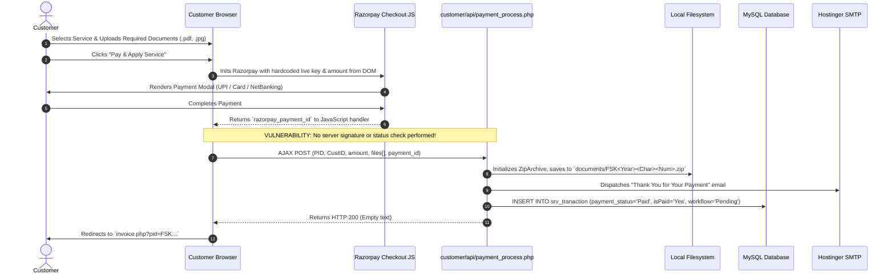
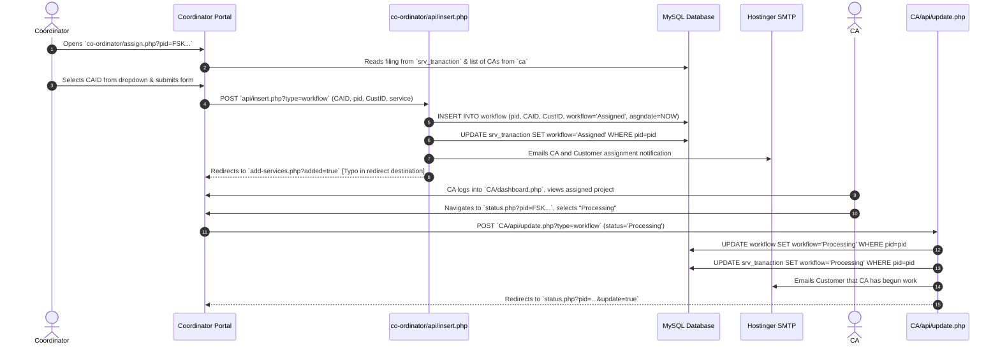
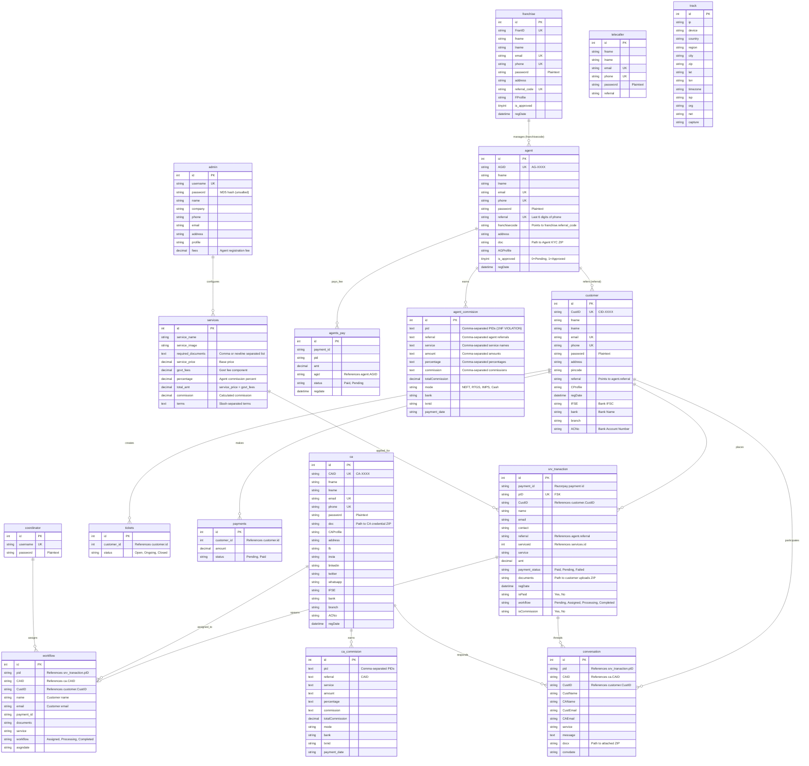
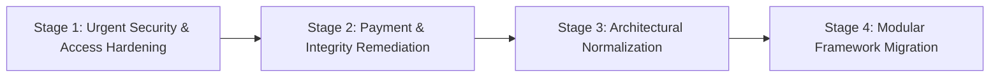

# Comprehensive Code-Level Audit & Architectural Reconstruction Report
**System**: Finservkart CA Filing & Financial Services Platform  
**Target Codebase**: `A:\finservkart-backend-backup`  
**Audit Date**: October 2026  
**Auditor Roles**: Senior Backend Engineer, Software Architect, Database Architect, Application Security Engineer, Technical Auditor  

---

## Executive Summary

A rigorous code-level investigation of the **Finservkart** backend repository (`A:\finservkart-backend-backup`) reveals a multi-portal financial services and Chartered Accountant (CA) filing platform developed using **procedural and mixed PDO/MySQLi PHP** without any formal framework or unified router.

The platform encompasses **7 distinct actor roles**:
1. **Customer** (`customer/`)
2. **Chartered Accountant / CA** (`CA/`)
3. **Agent / Partner** (`agent/`)
4. **Franchise / Franchisee** (`frenchise/` [sic])
5. **Coordinator** (`co-ordinator/`)
6. **Administrator** (`admin/admin/` and `admin/`)
7. **Telecaller** (`telecaller_login.php` & `telecaller_signup.php`)

### Key Findings at a Glance
* **Architectural Coupling & Duplicate Repositories**: The root directory contains an accidental nested copy of the entire project inside `admin/` (including an unmerged git submodule and 757 duplicated PHP scripts).
* **Critical Security Vulnerabilities**:
  * **Plaintext Passwords**: Customer, CA, Agent, Coordinator, Franchise, and Telecaller passwords are stored in clear text without hashing. The password recovery endpoint literally emails the user's plaintext password back to them.
  * **Systemic SQL Injection**: Critical endpoints (e.g., admin authentication, record deletion, ticket updates, payment status toggles, customer retrieval) use direct string concatenation into SQL queries.
  * **Unauthenticated Access (Zero RBAC/ABAC)**: Critical mutation and deletion endpoints (e.g., `admin/admin/api/delete.php`, `co-ordinator/api/payout.php`, `customer/api/payment_process.php`, `update_payment_status.php`) perform **zero session or permission validation**.
  * **Flawed Session Guards (PHP Syntax Bug)**: Throughout almost all portal dashboards and management scripts, session guards use `if (strlen($_SESSION['id']==0))` or lack `exit;` / `die();` after `header('Location: ...')`, allowing unauthenticated HTTP clients to continue executing protected pages.
  * **Client-Controlled Payments**: Payments are executed purely client-side via Razorpay JS checkout (`rzp_live_*`). The backend receives a `payment_id` via AJAX and marks transactions as `"Paid"` without server-side verification of payment status or HMAC webhook signature.
  * **Insecure Direct Object Reference (IDOR) & Document Exposure**: Customer tax zip files (`FSK<YY><Char><Num>.zip`) and conversation attachments (`../docs/<uniqid>.zip`) are stored in public web-accessible directories without authentication guards. With only ~2,340 possible PID permutations per year, documents can be easily brute-forced.
* **Incomplete & Broken Subsystems**:
  * `telecaller/`: The portal directory is completely missing; logging in attempts to redirect to a nonexistent `telecaller/dashboard.php` (404).
  * `customer/api/req.php`: Customer bank details update fails with a SQL syntax error due to an invalid `sprintf()` format specifier.
  * `co-ordinator/agent-commission.php`: Date range filtering condition `if (!empty($formdate) && empty($todate))` contains an inverted boolean condition that disables date filtering when both dates are entered.
  * `SabPaisaPostPgResponse.php`: Legacy/abandoned payment callback code containing commented-out database logic from an old student portal project.

---

## Phase 1: Complete Codebase Discovery & Inventory

### Directory Structure & Topology
```text
A:\finservkart-backend-backup\
├── Authentication.php          # SabPaisa AES-128-CBC cipher helper class
├── config.php                  # Global MySQLi database connection ($con)
├── db_connection.php           # Alternative global MySQLi connection ($conn)
├── capture.php                 # Visitor tracking via synchronous external HTTP call to ip-api.com
├── customer.php                # Customer public login endpoint
├── user-signup.php             # Customer registration endpoint
├── user-password-recovery.php  # Customer password recovery (plaintext email)
├── ca-login.php                # CA public login endpoint
├── ca-signup.php               # CA registration endpoint
├── ca-password-recovery.php    # CA password recovery
├── agent.php                   # Agent public login endpoint
├── agent-signup.php            # Agent registration endpoint (requires registration fee)
├── agent-password-recovery.php # Agent password recovery
├── telecaller_login.php        # Telecaller login endpoint
├── telecaller_signup.php       # Telecaller registration endpoint
├── index.php / about.php / ... # Public marketing and service catalog pages
├── invoice.php                 # Public invoice view and printable download
├── payments.php                # Unprotected payment inspection and status toggler
├── tickets.php                 # Unprotected ticket inspection and status toggler
├── update_payment_status.php   # Unprotected payment status mutator
├── update_ticket_status.php    # Unprotected ticket status mutator
├── test.php                    # phpinfo() diagnostic script (Information leak)
│
├── api.function/               # Shared backend API endpoints
│   ├── db.php                  # PDO database configuration ($pdo / $GLOBALS['conn'])
│   ├── agent.php               # Agent registration processor & pay entry
│   ├── agent_reg_api#php       # Obsolete/corrupted file with '#' in filename
│   ├── app_agent.php           # Mobile APK agent registration endpoint
│   ├── ca_reg_api.php          # CA registration processor (with file zip creation)
│   ├── customer_reg_api.php    # Customer registration processor
│   ├── franchise_reg_api.php   # Franchise registration processor
│   ├── contact_api.php         # Contact form processor (fails on blank DB password)
│   ├── check_*                 # Real-time AJAX validation endpoints (email, phone, referral)
│   ├── payment_process.php     # Public payment ingestion endpoint
│   ├── workflow_data.php       # Monthly workflow analytics JSON feed
│   └── uploads/                # File upload destination (CA, agent, franchise)
│
├── customer/                   # Customer Portal
│   ├── dashboard.php           # Customer dashboard (services, agent info, stats)
│   ├── services.php            # Service catalog with document checklists
│   ├── buy-service.php         # Document upload and Razorpay client integration
│   ├── my-services.php         # List of paid transactions and invoices
│   ├── my-workflow.php         # Service assignment tracking (Pending, Assigned, Processing, Completed)
│   ├── conversation.php        # Ticket/chat list for specific filing request
│   ├── new-conversation.php    # Message and document upload to CA
│   ├── chat_socket.php         # Message dispatcher (creates ZIP, sends PHPMailer notification)
│   ├── view.php                # Thread details and chat history
│   ├── profile.php             # Customer profile and bank account editor
│   └── api/
│       ├── payment_process.php # Transaction insertion into `srv_tranaction`
│       ├── insert.php          # Unrelated template boilerplate (gallery/testimonials)
│       ├── update.php          # Profile update handler
│       ├── req.php             # Bank details updater (BROKEN syntax)
│       └── documents/          # Customer uploaded zip archive storage
│
├── CA/                         # Chartered Accountant Portal
│   ├── dashboard.php           # CA statistics, active tasks, earnings
│   ├── my-workflow.php         # Assigned workflow queue
│   ├── status.php              # Project status mutator (Assigned -> Processing -> Completed)
│   ├── conversation.php        # CA-Customer communication hub
│   ├── new-conversation.php    # Message & filing delivery to Customer
│   ├── chat_socket.php         # Message and final document dispatcher
│   ├── payments-reports.php    # Commission and payout report view
│   ├── pending-commission.php  # CA commission ledger
│   └── api/
│       └── update.php          # Workflow transition handler & client notification
│
├── agent/                      # Agent / Partner Portal
│   ├── dashboard.php           # Agent stats, commission balance, customer count
│   ├── add-customer.php        # Onboards customers tagged to agent referral code
│   ├── services.php            # Service catalog
│   ├── buy-service.php         # Purchase service on behalf of tagged customer
│   ├── my-services.php         # Agent-initiated service transactions
│   ├── billing.php             # Customer billing history
│   ├── pending-commission.php  # Agent pending commissions
│   ├── customer-list.php       # BROKEN: 0 bytes empty file
│   └── api/
│       ├── addcustomer.php     # Agent customer insertion
│       ├── getCustomerDetails.php # IDOR: Returns full customer profile by CustID
│       └── payment_process.php # Agent order payment processor
│
├── frenchise/ [sic]            # Franchise Portal
│   ├── dashboard.php           # Franchise overview
│   ├── manage-agent.php        # Agents linked to franchise referral code
│   ├── manage-customer.php     # Customers under franchise
│   ├── agent-commission.php    # Franchise agent commissions
│   ├── buy-service.php         # Franchise-initiated filings
│   └── api/                    # Replicated customer API scripts
│
├── co-ordinator/               # Coordinator Portal (Ops Team)
│   ├── dashboard.php           # Operational workload, unassigned filings
│   ├── assign.php              # Form to assign paid filings to CAs
│   ├── assigned-workflow.php   # Filings currently Assigned
│   ├── process-workflow.php    # Filings in Processing
│   ├── complete-workflow.php   # Completed filings archive
│   ├── agent-commission.php    # Agent commission calculator and batch selector
│   ├── agents-payout.php       # Agent payout history
│   ├── manage-ca.php           # CA directory
│   ├── manage-agent.php        # Agent directory
│   ├── manage-customer.php     # Customer directory
│   ├── manage-services.php     # Service catalog CRUD
│   ├── add-services.php        # Add service with pricing and agent cut
│   └── api/
│       ├── insert.php          # Workflow assignment & service creation
│       ├── payout.php          # Agent commission batch disbursement
│       ├── ca_api_payout.php   # CA commission payout execution
│       └── delete.php          # Unprotected record deleter
│
├── admin/                      # Administrator Portal (Contains nested repo duplicate)
│   ├── admin/                  # True Admin Portal implementation
│   │   ├── dashboard.php       # Master revenue, fee settings, KPIs
│   │   ├── assign.php          # Admin assignment fallback
│   │   ├── ca-commission.php   # CA commission management
│   │   ├── french-commission.php # Franchise commission management
│   │   ├── manage-services.php # Global service catalog management
│   │   └── api/
│   │       ├── delete.php      # Unauthenticated record deletion via GET
│   │       └── ...
│   └── [accidental duplicate tree: admin, agent, customer, CA, co-ordinator...]
│
├── apps/                       # Mobile Distribution
│   ├── Finservkart_v1.apk      # Legacy Android app
│   ├── FinservKart-Agent.apk   # Dedicated agent Android app
│   └── FinservKartV2.apk       # Customer version 2 APK
│
├── docs/                       # Chat & Conversation attachment storage (.zip)
├── smtp/                       # Legacy PHPMailer 5.x library
└── include/                    # Public web template headers, footers, config
```

### Important Backend Files Inventory

| File Path | Responsibility | Dependencies | Database Access | API / Endpoints Exposed | Security Relevance | Verified Problems |
| :--- | :--- | :--- | :--- | :--- | :--- | :--- |
| `config.php` | Main database connection | `mysqli` | Connects to `finservkart` DB | None | Hardcoded DB password: `WindRed@12345` | Global connection lacks error handling for connection loss. |
| `db_connection.php` | Redundant DB connection | `mysqli` | Connects to `finservkart` DB | None | Hardcoded DB credentials | Redundant duplicate of `config.php`. |
| `api.function/db.php` | PDO Database configuration | `PDO` | Connects to `finservkart` DB | None | Exposes PDO via `$GLOBALS['conn']` | Hardcoded credentials; sets exception mode globally. |
| `customer.php` | Customer public login | `capture.php`, `config.php` | `SELECT customer` | `POST customer.php` | Compares plaintext password; direct SQL injection | Critical SQL Injection: `email='$useremail' and password='$dec_password'`. Plaintext password. |
| `ca-login.php` | CA portal login | `capture.php`, `config.php` | `SELECT ca` | `POST ca-login.php` | Compares plaintext password; direct SQL injection | Critical SQL Injection: `email='$useremail' and password='$dec_password'`. Plaintext password. |
| `agent.php` | Agent portal login | `capture.php`, `config.php` | `SELECT agent` | `POST agent.php` | Compares plaintext password; direct SQL injection | SQL Injection; fails to check `is_approved` status during login. |
| `admin/admin/index.php` | Admin portal login | `config.php` | `SELECT admin` | `POST index.php` | MD5 hashed password without salt | Critical SQL Injection on `$adminusername`. Bypassable via `' OR '1'='1`. |
| `customer/api/payment_process.php` | Order creation & payment ingestion | `PHPMailer`, `db.php` | `INSERT srv_tranaction` | `POST /customer/api/payment_process.php` | Unauthenticated order and payment insertion | **Zero payment verification**: Razorpay `payment_id` trusted without server validation. No signature check. |
| `customer/buy-service.php` | Document upload & checkout frontend | Razorpay JS SDK, jQuery | `SELECT customer`, `SELECT services` | Web UI | Hardcoded live Razorpay key (`rzp_live_wHDSacVlpdLgtE`) | Hidden fields allow client tampering of `amount` and `CustID`. |
| `co-ordinator/assign.php` | Assigns filings to CAs | `config.php` | `SELECT srv_tranaction`, `SELECT ca` | `POST api/insert.php?type=workflow` | Broken authorization guard | Checks `$_SESSION['adminid']` instead of coordinator session; no `exit;` on redirect. |
| `co-ordinator/api/insert.php` | Workflow assignment & email dispatcher | `PHPMailer`, `db.php` | `INSERT workflow`, `UPDATE srv_tranaction` | `POST api/insert.php` | Unauthenticated mutation endpoint | Anyone can POST and assign any CA to any transaction. Hardcoded SMTP credentials. |
| `CA/api/update.php` | Updates project status & notifies client | `PHPMailer`, `db.php` | `UPDATE workflow`, `UPDATE srv_tranaction` | `POST CA/api/update.php` | Unauthenticated workflow status update | No session verification. CA can mark completed without uploading deliverables. |
| `customer/chat_socket.php` | Chat & file upload handler | `PHPMailer`, `ZipArchive` | `INSERT conversation` | `POST chat_socket.php` | Creates public zip archives in `../docs/` | Misleading name: not a WebSocket. Public arbitrary file upload without extension filter. |
| `admin/admin/api/delete.php` | Global entity deleter | `db.php` | `DELETE FROM $table WHERE id = $id` | `GET api/delete.php?type=...&id=...` | **CRITICAL**: Remote unauthenticated deletion | Remote attackers can delete all customers, CAs, agents, or services via unauthenticated GET request. SQL Injection in `$id`. |
| `user-password-recovery.php` | Customer password recovery | `PHPMailer`, `config.php` | `SELECT customer` | `POST user-password-recovery.php` | Plaintext credential disclosure | Extracts and emails plaintext password to user. No reset token mechanism. |
| `update_payment_status.php` | Payment status mutator | `db_connection.php` | `UPDATE payments` | `POST update_payment_status.php` | Direct SQL injection; unauthenticated | Allows arbitrary public modification of payment status. |
| `capture.php` | Real-time analytics tracking | `ip-api.com`, `PDO` | `INSERT track` | Included in all auth files | Synchronous external HTTP call | Blocks page render on slow external HTTP request; leaks visitor IPs; DB password hardcoded. |
| `agent/customer-list.php` | Agent customer listing | None | None | Web UI | Zero byte file | Completely blank/unimplemented file. |

---

## Phase 2: Application Architecture Reconstruction

### Actual Internal Architecture
The application does **not** employ MVC, modern OOP abstractions, service layers, repositories, or automated routers. Instead, it follows a **direct procedural PHP endpoint model**:
1. **Entry Points**: Browsers and mobile clients request `.php` scripts directly via HTTP GET/POST.
2. **Session Model**: Native PHP sessions (`session_start()`). Sessions are compartmentalized inconsistently:
   * Customer: `$_SESSION['id']`
   * CA: `$_SESSION['id']`
   * Agent: `$_SESSION['id']`
   * Franchise: `$_SESSION['id']`
   * Coordinator: `$_SESSION['coordinatorid']` (interspersed with buggy checks for `$_SESSION['adminid']`)
   * Admin: `$_SESSION['adminid']`
   * *Critical Conflict*: Because Customer, CA, Agent, and Franchise all use `$_SESSION['id']` without namespace isolation, logging into one portal in the same browser session can overwrite or cross-contaminate access to another portal.
3. **Database Layer**: Dual-driver architecture:
   * Procedural `mysqli` (via `$con` in `config.php`) used for presentation views.
   * `PDO` (via `$conn` in `api/db.php`) used for API insert/update operations.
   * Uncoordinated manual transactions without `START TRANSACTION` / `COMMIT`.
4. **Communication Pattern**: Mixed AJAX and full-page HTML form posts with embedded Toastr alerts and SweetAlert2 triggers.

---

### End-to-End System Architecture

```mermaid
graph TD
    Client[Web Browser / Android APK] --> WebServer[Apache / Nginx Web Server]
    
    subgraph "Authentication & Public Layer"
        WebServer --> PublicAuth[customer.php / agent.php / ca-login.php / admin/index.php]
        PublicAuth --> Track[capture.php -> Synchronous Call to ip-api.com]
        PublicAuth --> DB_Auth[(MySQL: customer / ca / agent / admin)]
    end

    subgraph "Customer Journey"
        WebServer --> CustPortal[customer/dashboard.php & services.php]
        CustPortal --> BuyService[customer/buy-service.php]
        BuyService -->|Client-side JS| RZP[Razorpay Payment Gateway]
        RZP -->|Returns payment_id to JS| BuyService
        BuyService -->|AJAX POST FormData + Files| CustPayAPI[customer/api/payment_process.php]
        CustPayAPI -->|Create ZIP archive| CustDocs[customer/api/documents/FSK_PID.zip]
        CustPayAPI -->|Insert Record| DB_Trans[(srv_tranaction)]
        CustPayAPI -->|Direct SMTP| MailServer[smtp.hostinger.com:587]
    end

    subgraph "Operational Workflow & Assignment"
        WebServer --> CoordPortal[co-ordinator/dashboard.php & assign.php]
        CoordPortal -->|Read Paid Filings| DB_Trans
        CoordPortal -->|Assign CA| CoordAPI[co-ordinator/api/insert.php]
        CoordAPI -->|Insert Assignment| DB_Workflow[(workflow)]
        CoordAPI -->|Update Status = 'Assigned'| DB_Trans
        CoordAPI -->|Notification Email| MailServer
    end

    subgraph "CA Execution & Filing Delivery"
        WebServer --> CAPortal[CA/dashboard.php & my-workflow.php]
        CAPortal -->|Read Assigned Tasks| DB_Workflow
        CAPortal -->|Update Status: Processing / Completed| CAUpdateAPI[CA/api/update.php]
        CAUpdateAPI -->|Update State| DB_Workflow
        CAUpdateAPI -->|Update State| DB_Trans
        CAUpdateAPI -->|Status Notification| MailServer
        
        CAPortal --> CAChat[CA/conversation.php & new-conversation.php]
        CustPortal --> CustChat[customer/conversation.php & new-conversation.php]
        CAChat --> ChatSocket[chat_socket.php]
        CustChat --> ChatSocket
        ChatSocket -->|Upload Attachments| DocsStorage[docs/uniqid.zip]
        ChatSocket -->|Insert Message| DB_Conv[(conversation)]
        ChatSocket -->|Email Dispatch| MailServer
    end

    subgraph "Commission & Payout Management"
        WebServer --> AdminPortal[admin/admin/dashboard.php & ca-commission.php]
        CoordPortal --> CoordComm[co-ordinator/agent-commission.php]
        CoordComm -->|Batch Pay Agents| PayoutAPI[co-ordinator/api/payout.php]
        PayoutAPI -->|Insert Comma-delimited PIDs| DB_AgentComm[(agent_commision)]
        PayoutAPI -->|UPDATE isCommission = 'Yes'| DB_Trans
        AdminPortal --> CAPayoutAPI[admin/api/ca_api_payout.php]
        CAPayoutAPI -->|Insert Record| DB_CAComm[(ca_commision)]
    end
```



---

### Request Lifecycle Flowcharts

#### 1. Representative Customer Action: Service Purchase & Filing Submission



#### 2. Representative Administrative Action: Workflow Assignment & Processing



---

## Phase 3: CA Filing Business Domain Analysis

### Supported Services Catalog
The services catalog is stored dynamically in the `services` table. Based on production records and code references, the application supports:
1. **Income Tax Return (ITR)** (ITR-1, ITR-2, ITR-3, ITR-4, Business ITR)
2. **GST Registration & GST Return Filing** (GSTR-1, GSTR-3B, GSTR-9)
3. **Company & LLP Incorporation / ROC Compliance**
4. **TDS Return Filing & Tax Planning**
5. **MSME / Udyam Registration**
6. **Accounting & Bookkeeping Services**
7. **Trademark & Intellectual Property Filings**

---

### Core Business Workflows: Code-Level Evaluation

#### 1. Workflow: Filing Request Creation & Payment Processing
* **Trigger**: Customer or Agent submits form on `customer/buy-service.php` or `agent/buy-service.php`.
* **Allowed Roles**: `customer`, `agent`, `frenchise`.
* **Handling File**: `customer/api/payment_process.php` / `agent/api/payment_process.php`.
* **Data Collected**: `payment_id`, `pID`, `CustID`, `name`, `email`, `contact`, `referral`, `serviceid`, `service`, `amt`, `file[]`.
* **Validation Rules**: Client-side HTML5 input validation; client-side file extension filter (`.xlsx, .xls, .csv, .pdf, .png, .jpg, .jpeg, .doc, .docx, .txt, .pptx, .zip, .rar`). **Zero server-side validation** of file extensions or file size.
* **Database Tables Read/Modified**:
  * Read: `services` (pricing, documents)
  * Insert: `srv_tranaction`
* **Success Result**: ZIP created in `customer/api/documents/`, email sent via Hostinger SMTP, response sent to browser, redirection to `invoice.php?pid=...`.
* **Failure Result**: PHP `die("Couldn't create Zip Archive")` or PDO exception echo.
* **Allowed Status Transitions**: Initial state set directly to `payment_status = 'Paid'`, `isPaid = 'Yes'`, `workflow = 'Pending'`, `isCommission = 'No'`.
* **Double Submission**: If submitted twice with the same `pID`, `srv_tranaction` will throw a duplicate primary/unique key error (if indexed) or create duplicate records.
* **Transactional Guarantee**: **None**. File upload, email dispatch, and database insert are non-transactional. If the database insert fails, the email has already been sent and the ZIP file remains orphaned on disk.
* **Bypassability**: **Completely bypassable**. Any external script can POST to `payment_process.php` with a fabricated `payment_id` and zero payment, creating a valid "Paid" transaction.

#### 2. Workflow: CA Assignment
* **Trigger**: Coordinator or Admin selects a CA from the dropdown on `co-ordinator/assign.php`.
* **Allowed Roles**: Coordinator, Admin.
* **Handling File**: `co-ordinator/api/insert.php` (case `"workflow"`).
* **Data Collected**: `pid`, `CAID`, `name`, `email`, `payment_id`, `CustID`, `documents`, `service`, `workflow` (defaults to `"Assigned"`).
* **Validation Rules**: `required` attribute on HTML select. No verification that CA exists or is active.
* **Database Tables Read/Modified**:
  * Insert: `workflow`
  * Update: `srv_tranaction` (`SET workflow = 'Assigned' WHERE pid = ?`)
* **Success Result**: Client emailed notification of assignment; Coordinator redirected to `add-services.php?added=true` (erroneous redirect).
* **Failure Result**: PDO exception printed to output.
* **Permissions Check**: Relies on `$_SESSION['adminid']` (which breaks for coordinators logging in with `$_SESSION['coordinatorid']`).

#### 3. Workflow: CA Execution & Status Transitions
* **Trigger**: CA selects new status on `CA/status.php`.
* **Allowed Roles**: CA.
* **Handling File**: `CA/api/update.php` (case `"workflow"`).
* **State Machine & Status Transitions**:
  * `Assigned` $\rightarrow$ `Processing`
  * `Processing` $\rightarrow$ `Completed`
  * `Completed` $\rightarrow$ Terminal state (no further transitions permitted in UI)
* **Success Result**:
  * If `Processing`: Dispatches "Your Project has Started" email to customer.
  * If `Completed`: Dispatches "Your Project has Completed" email to customer.
  * Updates both `workflow` and `srv_tranaction` tables.
* **Failure Result**: Echoes PDO exception.
* **Integrity Weakness**: Status transitions rely on hidden inputs (`name`, `email`, `service`) submitted from the CA's browser rather than reading canonical values from the database.

#### 4. Workflow: Customer-CA Collaboration & Deliverable Exchange
* **Trigger**: Either Customer or CA posts a message via `new-conversation.php`.
* **Allowed Roles**: Customer, CA.
* **Handling File**: `customer/chat_socket.php` and `CA/chat_socket.php`.
* **Data Collected**: `pid`, `CAID`, `CustID`, `CustName`, `CAName`, `CustEmail`, `CAEmail`, `service`, `sub`, `message`, `file[]`.
* **File Handling**: Files packaged into `../docs/<uniqid()>.zip`.
* **Database Tables Modified**: `INSERT INTO conversation`.
* **Notifications**: Email dispatched with public link: `https://finservkart.com/docs/<zipFileName>`.
* **Security Risk**: Zero document encryption; zero access control on downloaded files.

#### 5. Workflow: Commission Calculation & Disbursement
* **Trigger**: Coordinator selects agent referrals on `co-ordinator/agent-commission.php` and clicks "Process To Pay".
* **Allowed Roles**: Coordinator, Admin.
* **Handling File**: `co-ordinator/api/payout.php`.
* **Business Rules**:
  * Service has configured `percentage` and calculated `commission`.
  * Filings with `isCommission = 'No'` are listed.
  * Coordinator fills out Mode, Bank, TxnID.
* **Database Updates**:
  * `INSERT INTO agent_commision` (Stores comma-separated list of PIDs, referrals, amounts, percentages).
  * `UPDATE srv_tranaction SET isCommission = 'Yes' WHERE pID IN (?)`.
* **Flaws**:
  * PIDs stored as comma-separated string in a single column (`pid`), violating First Normal Form (1NF).
  * No rollback if the transaction update fails after commission insert.

---

## Phase 4: Database Architecture & Schema Reconstruction

### Entity-Relationship Model



---

### Database Integrity & Design Deficiencies

1. **Complete Absence of Foreign Key Constraints**:
   * No `FOREIGN KEY ... REFERENCES` constraints exist between `srv_tranaction`, `workflow`, `conversation`, `customer`, `ca`, and `agent`.
   * Deleting an agent, customer, or CA via `admin/admin/api/delete.php` leaves orphan records scattered across `srv_tranaction`, `workflow`, and `conversation`.
2. **First Normal Form (1NF) Violations**:
   * `agent_commision` and `ca_commision` store comma-separated lists of values (`$pIDs`, `$referrals`, `$amounts`) in single text columns:
     ```php
     // co-ordinator/api/payout.php line 27
     $insertStmt->bind_param("sssssssssss", $pIDs, $referrals, $services, $amounts, ...);
     ```
   * It is impossible to index individual transactions, execute standard relational joins, or audit payouts by PID without string-splitting functions.
3. **Table Naming Inconsistencies & Typographical Errors**:
   * The core transactional table is named `srv_tranaction` (missing the 's' in `transaction`). Several files reference `srv_transaction`, leading to silent failures or conflicting queries.
   * Commission tables are named `agent_commision` and `ca_commision` (spelled with single 's').
   * Role directory is named `frenchise/`, while the database table is named `franchise`.
4. **Denormalization and Data Redundancy**:
   * `srv_tranaction` duplicates `name`, `email`, `contact`, `referral`, and `service` from `customer` and `services`.
   * `workflow` duplicates `name`, `email`, `service`, `documents`, and `payment_id` from `srv_tranaction`.
   * If a customer updates their email or phone in `customer/profile.php`, existing filing records retain stale information.
5. **Dual Status Synchronization Hazard**:
   * Both `srv_tranaction.workflow` and `workflow.workflow` store the state of the filing (`Assigned`, `Processing`, `Completed`). Updates require updating both tables simultaneously; failure in one update leaves the system in a permanently desynchronized state.

---

## Phase 5: Authentication, Authorization, Payments & Documents

### 1. Authentication Breakdown
* **Mechanisms**: Session-based authentication via standard PHP `$_SESSION`.
* **Password Storage**:
  * **Customer, CA, Agent, Coordinator, Franchise, Telecaller**: Stored in **plain text**.
  * **Admin**: Stored as **MD5 hash without salt** (`md5($_POST['password'])`), vulnerable to rainbow tables.
* **Credential Transport**:
  * Login requests send passwords over HTTP POST.
  * Welcome and registration confirmation emails transmit the user's password in **clear text** via unencrypted email body.
  * Password recovery scripts query the database and send the clear text password back via email.

### 2. Authorization & Access Control Breakdown
* **Flawed Session Guards**:
  In nearly all role-protected pages (`customer/my-services.php`, `CA/status.php`, `co-ordinator/assign.php`, `co-ordinator/agent-commission.php`):
  ```php
  if (strlen($_SESSION['id']==0)) {
      header('location:logout.php');
  }
  ```
  * `$_SESSION['id'] == 0` evaluates to boolean `false` (0) or `true` (1).
  * `strlen(false)` is `0`; `strlen(true)` is `1`.
  * If a session is valid and non-zero, `strlen(false)` evaluates to `0`, meaning the `if` statement is `false` and execution proceeds.
  * More critically: **`exit;` or `die();` is missing after `header('location:logout.php')`**. Even if the redirect header is emitted, PHP continues executing the entire page script, evaluating all database queries, and sending full HTML and sensitive customer data down to the client.
* **Missing Role Separation**:
  * `customer/dashboard.php`, `CA/dashboard.php`, `agent/dashboard.php`, and `frenchise/dashboard.php` all check `$_SESSION['id']`.
  * If a Customer logs in (`$_SESSION['id'] = 5`), and subsequently visits `CA/dashboard.php` or `agent/dashboard.php`, the system reads user ID 5 from the `ca` or `agent` table, allowing cross-portal privilege escalation.

### 3. Payment Processing Architecture
* **Integrated Gateway**: Razorpay (client-side checkout) and abandoned SabPaisa code.
* **Client-Side Flow**:
  1. `buy-service.php` reads the fee from hidden input `<input type="hidden" name="amount" value="...">`.
  2. JavaScript opens Razorpay modal with hardcoded live API keys:
     * Customer key: `rzp_live_wHDSacVlpdLgtE`
     * Agent key: `rzp_live_ICzjw9iEib4V6g`
  3. Razorpay client modal triggers `handler(response)` on payment completion.
  4. JavaScript extracts `response.razorpay_payment_id` and fires an AJAX POST to `./api/payment_process.php`.
* **Server-Side Ingestion**:
  * `payment_process.php` reads `$_POST['payment_id']` directly from the request.
  * **No signature verification** (`razorpay_signature` is neither received nor verified against the Razorpay webhook/API secret).
  * The backend sets `$payment_status = "Paid"` and `$isPaid = "Yes"` without contacting Razorpay's API to confirm transaction state or capture the funds.
  * Any user can send a cURL request with `payment_id=fake_pay_123` and purchase any filing service for free.

### 4. Document Uploads & Storage Architecture
* **Upload Mechanism**: Standard `enctype="multipart/form-data"` processed via PHP `ZipArchive`.
* **Storage Paths**:
  * Customer filing documents: `customer/api/documents/FSK<YY><Char><Num>.zip`
  * CA credentials: `api.function/uploads/CA/<CAID>.zip`
  * Agent KYC: `api.function/uploads/agent/<AGID>.zip`
  * Conversation messages: `docs/<uniqid()>.zip`
* **Vulnerabilities**:
  * **Public Access**: All upload directories (`customer/api/documents/`, `docs/`, `api.function/uploads/`) reside inside the web server document root and lack `.htaccess` or authentication checks. Anyone with the URL can download tax returns, PAN cards, and Aadhaar cards.
  * **Predictable Document Filenames**: Filenames follow `FSK` + 2-digit year + uppercase character + 2-digit number (e.g., `FSK24A12.zip`). The total search space is only $26 \times 90 = 2,340$ permutations per year, allowing complete mass enumeration and data harvesting in minutes.
  * **Arbitrary File Upload**: While client-side forms declare `accept=".pdf, .png..."`, server-side upload handlers in `payment_process.php` and `chat_socket.php` add all files directly into the ZIP archive without checking MIME types or extensions.

---

## Phase 6: Feature Status & Gap Audit

| Feature / Module | Status | Implementation Details | Verified Defects / Missing Components |
| :--- | :--- | :--- | :--- |
| **Customer Registration** | **Implemented** | `user-signup.php`, `customer_reg_api.php` | Plaintext password stored and emailed; self-assigned `CustID`. |
| **Customer Login** | **Implemented** | `customer.php` | Vulnerable to SQL injection; no rate limiting or lockout. |
| **Customer Service Catalog** | **Implemented** | `customer/services.php` | Reads from `services` table; links directly to `buy-service.php`. |
| **Customer Order Creation** | **Implemented** | `customer/buy-service.php` | Zero server-side payment verification; amount client-tamperable. |
| **Customer Workflow Tracker**| **Implemented** | `customer/my-workflow.php` | Status badges for Pending, Assigned, Processing, Completed. |
| **Customer-CA Chat/Messaging**| **Implemented** | `customer/conversation.php`, `chat_socket.php` | Procedural email+zip dispatch; not real-time; public zip link. |
| **Customer Bank Detail Edit**| **Broken** | `customer/api/req.php` | Uses `sprintf()` with `?`, generating invalid SQL query. |
| **CA Registration** | **Implemented** | `ca-signup.php`, `ca_reg_api.php` | Plaintext passwords; path traversal risk in `CAID`. |
| **CA Work Queue** | **Implemented** | `CA/my-workflow.php` | Lists assigned filings. |
| **CA Status Updating** | **Implemented** | `CA/status.php`, `CA/api/update.php` | Transitions status and emails client; zero validation of deliverables. |
| **CA Commission View** | **Implemented** | `CA/pending-commission.php` | Views earnings. |
| **Agent Registration** | **Implemented** | `agent-signup.php`, `api.function/agent.php`| Requires admin approval (`is_approved=0`), but bypassable. |
| **Agent Login Guard** | **Broken** | `agent.php` | Query omits `is_approved=1` check; unapproved agents can log in. |
| **Agent Customer Onboarding** | **Implemented** | `agent/add-customer.php`, `agent/api/addcustomer.php`| Tags customer to agent referral code. |
| **Agent Customer List** | **Broken** | `agent/customer-list.php` | **0 bytes empty file**; feature does not render or work. |
| **Coordinator Assignment** | **Incomplete/Broken**| `co-ordinator/assign.php` | Checks `$_SESSION['adminid']` instead of coordinator session; wrong redirect. |
| **Agent Commission Calculator**| **Broken** | `co-ordinator/agent-commission.php` | `if (!empty($formdate) && empty($todate))` logic error breaks date filtering. |
| **Coordinator Payout Execution**| **Implemented** | `co-ordinator/api/payout.php` | Violates 1NF (comma-separated values); zero authentication guard. |
| **Admin Service Catalog CRUD**| **Implemented** | `admin/admin/add-services.php`, `manage-services.php`| Admin can add/edit services, pricing, agent commissions. |
| **Admin Entity Deletion** | **Critical Risk** | `admin/admin/api/delete.php` | Unauthenticated GET endpoint; SQL injection; deletes records system-wide. |
| **Telecaller Portal** | **Missing** | `telecaller_login.php`, `telecaller_signup.php` | `telecaller/` folder does not exist; login redirects to 404 error. |
| **Public Tickets/Payments** | **Exposed/Broken** | `tickets.php`, `payments.php`, `update_*.php` | Publicly exposed debug pages; anyone can update payment/ticket status. |
| **SabPaisa Integration** | **Obsolete/Abandoned** | `SabPaisaPostPgRequest.php`, `SabPaisaPostPgResponse.php`| Commented out database update code; mismatched auth keys; unused. |
| **Visitor Tracking** | **Flawed** | `capture.php` | Synchronous HTTP calls to `ip-api.com` block logins; leaks user IP data. |
| **System Logging** | **Missing** | Across entire codebase | No unified logging; errors either echoed or swallowed via `errorInfo()`. |

---

## Phase 7: Application Security & Architectural Vulnerability Audit

### Security Vulnerability Matrix

| ID | Vulnerability | Severity | CWE | Location(s) | Impact |
| :--- | :--- | :--- | :--- | :--- | :--- |
| **SEC-01** | **Unauthenticated Remote Database Record Deletion** | **Critical** | CWE-306, CWE-89 | `admin/admin/api/delete.php:39` | Any unauthenticated remote attacker can delete all services, CAs, agents, customers, or tickets via a single GET request. |
| **SEC-02** | **Systemic Authentication Bypass via SQL Injection** | **Critical** | CWE-89 | `customer.php:12`, `agent.php:11`, `ca-login.php:12`, `admin/admin/index.php:8` | Complete authentication bypass on Admin, Customer, CA, and Agent portals without valid credentials. |
| **SEC-03** | **Cleartext Password Storage & Transmission** | **Critical** | CWE-256, CWE-319 | `customer_reg_api.php:138`, `user-password-recovery.php:20`, all user tables | Full credential theft; compromise of user, CA, and agent accounts; regulatory violation. |
| **SEC-04** | **Unverified Payment Ingestion (Zero Gateway Validation)** | **Critical** | CWE-353, CWE-345 | `customer/api/payment_process.php:24`, `agent/api/payment_process.php` | Fraudulent filing requests created with zero funds by submitting fabricated `payment_id` values. |
| **SEC-05** | **Public Tax Document Exposure & Predictable Identifiers** | **High** | CWE-200, CWE-330 | `customer/api/payment_process.php:36`, `customer/api/documents/` | Mass data exfiltration of sensitive financial, tax, and identity documents (ITR forms, PAN, Aadhaar). |
| **SEC-06** | **Unrestricted IDOR in Invoices & Customer Profiles** | **High** | CWE-639 | `invoice.php:4`, `agent/api/getCustomerDetails.php:5` | Any anonymous user can view invoices and dump customer personal details by iterating PID / CustID. |
| **SEC-07** | **Broken Authorization Guards (Missing `exit` after redirect)**| **High** | CWE-698 | `customer/my-services.php:4`, `co-ordinator/assign.php:4`, etc. | Unauthenticated requests bypass redirects and execute restricted page queries and logic. |
| **SEC-08** | **Public Payment & Ticket Mutator Endpoints** | **High** | CWE-306, CWE-89 | `update_payment_status.php:8`, `update_ticket_status.php:8` | Anonymous users can flip any payment to "Paid" and alter ticket statuses via direct POST. |
| **SEC-09** | **Hardcoded Secrets & Database Credentials** | **Medium** | CWE-798 | `config.php:4`, `customer/api/payment_process.php:78`, `SabPaisaPostPgRequest.php:11` | Exposure of database root passwords, Hostinger SMTP email credentials, and SabPaisa gateway keys. |
| **SEC-10** | **Information Disclosure via `phpinfo()`** | **Medium** | CWE-200 | `test.php:1` | Leaks server environment variables, PHP modules, OS build, and configuration directives. |
| **SEC-11** | **Denial of Service via Synchronous External API Calls** | **Medium** | CWE-400 | `capture.php:26` | Login page hangs or crashes whenever `ip-api.com` rate limits or experiences latency. |

---

### Detailed Vulnerability Proofs & Evidence

#### 1. Unauthenticated Remote Deletion (SEC-01)
* **File**: `admin/admin/api/delete.php` (Lines 4–46)
```php
$type = $_GET['type'];
$id = $_GET['id'];

if ($conn) {
    switch ($type) {
        case "services":
            delete($conn, $type, $id, "manage-services.php?isDeleted=true");
            break;
        case "ca":
            delete($conn, $type, $id, "manage-ca.php?isDeleted=true");
            break;
        case "customer":
            delete($conn, $type, $id, "manage-customer.php?isDeleted=true");
            break;
        ...
function delete($conn, $table, $id, $goto) {
    $sql = "DELETE FROM $table WHERE id = $id";
    $conn->exec($sql);
...
```
* **Vulnerability Analysis**:
  * There is **no session check** (`$_SESSION['adminid']` is never inspected).
  * The operation is triggered via HTTP **GET**.
  * `$id` is concatenated directly into `$sql` without parameterization or escaping.
  * **Exploit Scenario**: Sending `GET /admin/admin/api/delete.php?type=customer&id=1 OR 1=1` will truncate the entire customer table anonymously.

#### 2. Admin Authentication Bypass via SQL Injection (SEC-02)
* **File**: `admin/admin/index.php` (Lines 6–8)
```php
if(isset($_POST['login'])) {
    $adminusername = $_POST['username'];
    $pass = md5($_POST['password']);
    $ret = mysqli_query($con, "SELECT * FROM admin WHERE username='$adminusername' and password='$pass'");
    $num = mysqli_fetch_array($ret);
    if($num > 0) {
        $_SESSION['login'] = $_POST['username'];
        $_SESSION['adminid'] = $num['id'];
        ...
```
* **Vulnerability Analysis**:
  * `$adminusername` is embedded directly into the query string.
  * Supplying `admin' -- ` in the username field comments out the password check entirely:
    `SELECT * FROM admin WHERE username='admin' -- ' and password='...'`
  * Logs in immediately as Administrator without knowing the password.

#### 3. Unverified Client-Side Payment Ingestion (SEC-04)
* **File**: `customer/api/payment_process.php` (Lines 24–67, 292–298)
```php
if(isset($_POST['payment_id'], $_POST['pID'], $_POST['CustID'], ...)){
    ...
    $payment_id = $_POST['payment_id'];
    $pID = $_POST['pID'];
    $amt = $_POST['amt'];
    $payment_status = "Paid";
    $isPaid = "Yes";
    $workflow = "Pending";
    ...
    $sql = "INSERT INTO srv_tranaction (payment_id, pID, CustID, name, email, contact, referral, serviceid, service, amt, payment_status, documents, regdate, isPaid, workflow, isCommission) VALUES (?, ?, ?, ?, ?, ?, ?, ?, ?, ?, ?, ?, ?, ?, ?, ?)";
    $stmt = $conn->prepare($sql);
    $stmt->execute([...]);
```
* **Vulnerability Analysis**:
  * The server relies entirely on the presence of `$_POST['payment_id']`.
  * No call is made to Razorpay's API (`/v1/payments/{payment_id}`) to verify if the payment actually occurred, whether it succeeded, or if the amount matches the service catalog price.
  * An attacker can post arbitrary payment IDs, specify `amt = 0`, and submit legitimate filing tasks to CAs for free.

---

## Phase 8: Systemic Recommendations & Refactoring Roadmap

To remediate these critical architectural and security deficiencies **without breaking existing production workflows**, follow this structured 4-stage engineering roadmap:



### Stage 1: Immediate Security & Access Hardening (Zero Downtime)
1. **Patch All Session Authorization Guards**:
   * Replace buggy `strlen($_SESSION['id']==0)` with strict type and role validation:
     ```php
     if (!isset($_SESSION['auth_role']) || $_SESSION['auth_role'] !== 'coordinator') {
         header('Location: /login.php');
         exit();
     }
     ```
   * Ensure **`exit();`** immediately follows every `header('Location: ...')`.
2. **Lock Down Dangerous Endpoints**:
   * Delete or restrict `test.php`, `payments.php`, `tickets.php`, `update_payment_status.php`, and `update_ticket_status.php`.
   * Add session authentication and CSRF token verification to `admin/admin/api/delete.php` and convert it from GET to POST.
3. **Eliminate SQL Injections**:
   * Refactor all raw SQL concatenations (`customer.php`, `ca-login.php`, `agent.php`, `admin/admin/index.php`, `invoice.php`) to use prepared statements with parameter binding (`prepare()` + `bind_param()` or PDO `execute([$params])`).
4. **Clean Duplicate Repository**:
   * Remove the accidental duplicate repository folder inside `admin/` (retaining only the true `admin/admin/` code) to prevent version drift.

### Stage 2: Payment Verification & Document Access Remediation
1. **Implement Server-Side Razorpay Signature & Verification**:
   * Enforce order creation via Razorpay Orders API (`/v1/orders`) on the backend before checkout.
   * Verify the HMAC SHA256 signature (`razorpay_signature`) using the secret key on the server before inserting any record into `srv_tranaction`:
     ```php
     $expectedSignature = hash_hmac('sha256', $orderId . '|' . $paymentId, $razorpaySecret);
     if (!hash_equals($expectedSignature, $receivedSignature)) {
         http_response_code(400);
         die("Invalid payment signature");
     }
     ```
   * Set up an asynchronous Razorpay Webhook endpoint to reliably handle payment captures, cancellations, and refunds.
2. **Secure Document Storage**:
   * Move document directories (`documents/`, `docs/`, `uploads/`) outside the public web root (`public_html` / `www`).
   * Serve files through an authenticated download proxy (`download.php?file_id=...`) that verifies that `$_SESSION['id']` belongs to the requesting Customer, assigned CA, or Administrator.
   * Generate cryptographically secure random identifiers (UUIDv4) for filing folders and documents instead of predictable `FSK` IDs.
3. **Upgrade Password Storage**:
   * Implement `password_hash($password, PASSWORD_BCRYPT)` on signup.
   * Introduce a lazy migration mechanism on login: verify against bcrypt; if password matches cleartext, re-hash it using `password_hash()` and update the database row.
   * Overhaul password recovery: replace plaintext email dispatches with time-limited (15-minute), single-use cryptographic reset tokens.

### Stage 3: Database & Workflow Defect Remediation
1. **Fix Verified Code Bugs**:
   * **`customer/api/req.php`**: Correct the SQL query generation to use parameterized updates instead of the broken `sprintf()` question-mark pattern.
   * **`co-ordinator/agent-commission.php`**: Correct line 182 date filter logic from `if (!empty($formdate) && empty($todate))` to `if (!empty($formdate) && !empty($todate))`.
   * **`agent/customer-list.php`**: Implement the missing customer listing view for agents.
   * **`agent.php`**: Add `AND is_approved = 1` to the agent login query.
   * **`telecaller/`**: Either build the missing `telecaller/` portal directory or deactivate the telecaller registration option from the public site.
2. **Centralize Database Configuration**:
   * Unify `config.php`, `db_connection.php`, and `api.function/db.php` into a single, centralized database provider class reading environment variables (`.env`).
   * Normalize database table names: correct typo `srv_tranaction` to `srv_transactions` using a view alias to preserve backwards compatibility.
3. **Normalize Commission Tables (1NF)**:
   * Introduce a relational junction table `commission_items (id, commission_id, pid, amount, commission)` instead of storing comma-delimited strings in `agent_commision.pid`.

### Stage 4: Architectural Modernization & Scalability
1. **Asynchronous Background Processing**:
   * Decouple email dispatch and visitor analytics (`capture.php`) from HTTP request threads using a message queue (e.g., Redis + worker daemon).
   * Replace the synchronous blocking HTTP call to `ip-api.com` with an asynchronous job or localized MaxMind GeoIP database lookup.
2. **Unified API & Controller Layer**:
   * Gradually wrap portal logic into RESTful controller classes with centralized middleware handling Authentication, Authorization (RBAC), and Request Validation.
   * Separate backend API logic from HTML presentation to support both web portals and native Android apps cleanly.
